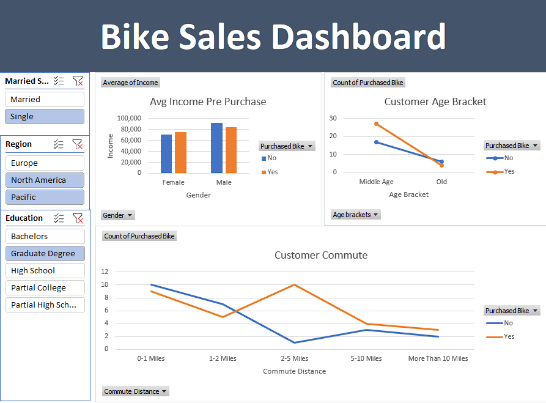

# 🚴 Bike Sales & Customer Demographics Analysis

## 📌 Project Overview
Proyek ini merupakan analisis data *end-to-end* menggunakan **Microsoft Excel** untuk mengeksplorasi data demografi pelanggan dan mengidentifikasi pola atau faktor yang memengaruhi keputusan seseorang dalam membeli sepeda. Proyek ini dibuat sebagai bagian dari pembelajaran mandiri untuk memperkuat fondasi *Data Analytics*.

---

## 🎯 Objectives
1. Melakukan pembersihan data (*data cleaning*) untuk memastikan integritas dan akurasi data.
2. Menganalisis korelasi antara variabel demografis (seperti pendapatan, usia, tingkat pendidikan, dan jarak tempuh) dengan perilaku pembelian sepeda.
3. Membangun *dashboard* interaktif yang bersih dan mudah dipahami oleh pemangku kepentingan (*stakeholders*).

---

## 🛠️ Tools & Skills Demonstrated
* **Tool:** Microsoft Excel
* **Techniques & Features:**
  * Data Cleaning & Preparation (Removing duplicates, handling blank values, text formatting)
  * Data Transformation (Conditional logic, lookup functions)
  * Data Aggregation (Pivot Tables & Pivot Charts)
  * Data Visualization & Interactivity (Dashboard design, Slicers)

---

## 📸 Dashboard Preview



---

## 📊 Key Insights & Findings
1. **Pendapatan (*Income*):** Rata-rata pelanggan yang memutuskan untuk membeli sepeda memiliki tingkat pendapatan yang cenderung lebih tinggi dibandingkan yang tidak membeli.
2. **Jarak Komuter (*Commute Distance*):** Pelanggan dengan jarak perjalanan harian **0–1 mil** mendominasi angka pembelian sepeda tertinggi.
3. **Kelompok Usia:** Segmen usia *Middle-Age* (31–54 tahun) merupakan kelompok pembeli paling aktif dibandingkan kelompok usia lainnya.

---

## 💡 Business Recommendations
* **Target Pemasaran:** Fokuskan kampanye promosi kepada kelompok usia *Middle-Age* yang tinggal dalam radius jarak dekat dari tempat kerja/aktivitas mereka.
* **Bundling Produk:** Menawarkan paket aksesori pendukung bagi komuter jarak dekat untuk meningkatkan nilai penjualan.

---

## 📁 Repository Structure
```text
bike-sales-excel-analysis/
│
├── data/                    <-- Berisi file Excel mentah / hasil analisis
│   └── bike_buyers.xlsx
|
├── img/                     <-- Berisi screenshot / tampilan dashboard
│   └── dashboard.png
│
└── README.md                <-- Dokumentasi proyek
---
*Dibuat oleh Arya Satria sebagai bagian dari portofolio Data Analytics.*
